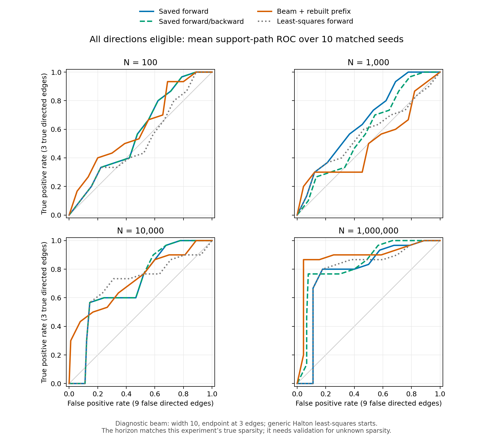

# Why releasing the upper restriction hurts support ROC

Audit date: 2026-10-12. All edge coordinates below are zero-based **matrix
positions**, following the experiment files. All four studies have 40 trials,
the same Lambda_star, matching empirical covariances and matching fixed
omega references (within 1e-12). The all-forward study uses the packaged
implementation; the other studies use the repository runner. Their common
fit settings are beta=1, max_iter=800, tol=1e-7, 10 Halton restarts and
zero_tol=1e-5. Lambda_star has diagonal (0.1, 0.25, 0.4, 0.55) and true
off-diagonal entries (0,3), (1,3), (2,3).

## Conclusions

The principal cause is a mismatch between greedy one-edge prediction and
joint support recovery. The best one-edge and two-edge models favor a wrong
direction even on population covariance. Forward nesting locks in that
choice. The present backward correction explores only deletions from the
single best extension, and subsequent prefix rebuilding can discard earlier
good sparse models. Better numerical fitting alone does not solve this.

There is also a statistical limitation: wrong sparse models approximate the
population covariance closely enough that sample noise changes their order.
With all directions available, raw training Frobenius loss often rewards
these alternatives. The upper restriction removes them by supplying the
correct node order in advance.

## Original results

| N | Upper: AUC / true on path / exact final | All forward | All forward/backward | All exhaustive: true on path / exact final |
|---:|:---|:---|:---|:---|
| 100 | .700 / 2/10 / 0/10 | .585 / 0/10 / 0/10 | .585 / 0/10 / 0/10 | 0/10 / 0/10 |
| 1,000 | .844 / 4/10 / 1/10 | .659 / 0/10 / 0/10 | .589 / 0/10 / 0/10 | 0/10 / 0/10 |
| 10,000 | 1.000 / 10/10 / 9/10 | .696 / 0/10 / 0/10 | .700 / 0/10 / 0/10 | 3/10 / 3/10 |
| 1,000,000 | 1.000 / 10/10 / 10/10 | .789 / 0/10 / 0/10 | .837 / 4/10 / 4/10 | 6/10 / 6/10 |

AUC is the arithmetic mean of trapezoidal areas of individual nested seed
paths. Upper has three false candidate edges, all has nine; compare true
support availability or raw FP counts as well as normalized FPR. Exhaustive
dimension winners are not nested and their connected curves can backtrack,
so no standard ranking AUC is assigned to those paths. The summary column
called "Average precision" is mean final-support precision, not PR-curve AP.

## 1. The first greedy choice is systematically wrong

At N=1,000,000, **all ten forward trials start with (3,2)**. All ten upper
trials start with the true position (2,3). The all-forward support with three
off-diagonal entries is always {(0,3), (1,3), (3,2)}.

An independent constrained nonlinear least-squares fitter, operating only on
allowed matrix entries, reproduces the problem on Sigma_population. With
omega_ref = .93 lambda_min(Sigma_population) = .9360864023:

| Model | Best tested residual squared |
|:---|---:|
| One edge: false (3,2) | .008885863496 |
| One edge: true (2,3) | .009361478781 |
| Best tested two-edge model: (0,3), (3,2) | .003980042828 |
| True two-edge prefix: (0,3), (2,3) | .004229921849 |
| True three-edge support | 3.11e-26 |
| Best tested wrong three-edge support: (0,3), (1,3), (3,2) | 1.189867526e-5 |

The true three-edge model wins among tested fits of all 220 supports, but its
two-edge prefix ranks fourth and its best single edge ranks second. These
are local optimizer results, not global optimality certificates. Adding
starts in all eight distinct diagonal-sign configurations leaves the leading
population supports and their losses unchanged. Fixing omega to the true
value 1 also leaves the reversed single edge preferable (.0113905462 versus
.0119020634). The fitted omega is therefore not the primary cause.

Reducing ADMM tolerance cannot repair a search rule whose population
one-edge optimum points in the wrong direction.

## 2. Why the current backward correction is incomplete

In optimizers/nested_search.py, lines 186–200, the algorithm chooses the best
one-edge extension first and tests deletions from that one extension. It
does not evaluate every same-size swap or every reversal. A noise-fitting
extension can win before the algorithm ever considers adding the missing
true direction and removing its reversal. Seed 2 at N=1,000,000 records zero
corrections despite a better true three-edge model being available.

Prefix rebuilding is a second issue. For N=1,000,000, seed 3, a correction at
D_m=5 improves the five-entry support objective from 2.35321147e-6 to
1.53272932e-6, but the rebuilt D_m=4 objective becomes .00370116838. The
original forward D_m=4 objective was 8.37906518e-6. Higher-dimensional
improvement is therefore allowed to greatly worsen the earlier ROC path.
The implementation explicitly permits this and retains historical scalar
objectives only, not historical masks as alternative paths.

## 3. Sampling noise overwhelms a small direction gap

The nearest wrong population three-edge fit has residual entries about
.001526 at (0,2) and .001902 at (1,2). The other entries are much smaller.
For independent Gaussian observations, Var(Sigma_hat_ij) =
(Sigma_ii Sigma_jj + Sigma_ij^2)/N. The standard errors at these leaf pairs
are .00110–.00113 at N=1,000,000 and .01097–.01127 at N=10,000.

This compares residual scales with covariance noise as an explanation of
weak signal; it is not a formal model-comparison test, since fitted residual
noise also depends on Lambda. Nevertheless, the saved samples confirm the
effect: at one million observations the wrong mixed-direction support has
lower fitted loss than the true support in seeds 173, 192, 237 and 3. At
10,000 observations the diagnostic search finds a wrong three-edge support
with lower loss than the fitted true support in every seed. More accurate
training-loss minimization alone consequently need not improve recovery.

Dense Lambda itself is not identifiable from one stationary covariance.
For any SPD Sigma and 0 < omega < lambda_min(Sigma),

    Lambda = Sigma^(-1/2) Q (Sigma - omega I)^(1/2),  Q orthogonal,

gives Lambda.T Sigma Lambda = Sigma - omega I. These exact solutions are
stable because their discrete Lyapunov equation has SPD noise omega I.
Sparsity can distinguish supports in particular instances, as the tested
population three-edge fits illustrate, but unrestricted covariance fitting
cannot identify an arbitrary directed matrix. This derivation concerns the
actual discrete equation in this repository, not a theorem for continuous
Lyapunov models.

## 4. Numerical fitting needs repair, but is secondary here

Both admm.py and the adjacent package source solve a full linear system and
then zero forbidden entries. For a column with permitted rows F, the actual
constrained quadratic update is A[F,F] x[F] = b[F]. In general, projecting
A^(-1)b does not give that solution. The convergence check also monitors
only the change in Lambda_1, without checking the primal/dual residuals or
the free-coordinate objective gradient.

For the population one-edge models, the returned ADMM fits have free
gradient infinity norms around .02, whereas direct least squares improves
their losses. However, the wrong direction remains preferable. On the
one-million-sample datasets, direct least squares with the same greedy
forward search has mean AUC .788889, exactly the saved forward AUC. Correct
optimization is necessary for reliable comparisons but insufficient for
the stated ROC goal.

The diagnostic uses [SciPy least_squares](https://docs.scipy.org/doc/scipy/reference/generated/scipy.optimize.least_squares.html)
with an analytic residual Jacobian, generic Halton starts and tight stopping
tolerances. Its local nature is important: some support fits need starts
from ADMM or additional sign configurations. Comparisons with saved
exhaustive winners include those starts; the beam prototype uses its own
generic starts without true parameters.

## 5. A tested search change

The prototype keeps the ten best candidate supports at each of the first
three edge counts. It selects the best three-edge endpoint, reconstructs its
nested prefix by deletion restricted to that endpoint, and then extends
forward. All 12 directed off-diagonal positions remain eligible. All tested
prototype paths are stable; their maximum spectral radius is .84019.

| N | Saved forward AUC | Least-squares forward AUC | Beam + rebuilt prefix AUC | Prototype true on path |
|---:|---:|---:|---:|---:|
| 100 | .585 | .522 | .615 | 0/10 |
| 1,000 | .659 | .567 | .504 | 0/10 |
| 10,000 | .696 | .685 | .726 | 0/10 |
| 1,000,000 | .789 | .789 | .885 | 6/10 |

On population covariance the prototype has AUC 1, while its least-squares
greedy counterpart has AUC .888889. At N=1,000,000 mean TPR at three edges
increases from 2/3 to .866667. This diagnoses a removable search bottleneck.
It does not establish a general solution: the horizon of three matches the
true sparsity in this experiment, performance declines at N=1,000, and the
prototype was not passed through final plateau/bootstrap dimension
selection. Do not interpret 6/10 true-on-path as 6/10 final recovery.



## Recommended next experiments, in priority order

1. **Allow reversals and all same-size swaps; keep multiple sparse paths.**
   At k entries, examine every retained-edge deletion paired with every
   excluded-edge addition, including direction reversal, instead of only
   deletions from the best extension. Cache fits. Keep best masks per
   cardinality and competing nested paths. Select a plausible sparse
   endpoint before reconstructing its prefix; do not let a later dense
   noise-fitting model overwrite the sparse ranking. For n=4, enumeration of
   all supports through three edges needs only 1+12+66+220=299 masks and is a
   useful reference benchmark. Select the horizon from training criteria or
   validation and test it on separate truths, rather than fixing it from
   known true sparsity.

2. **Test a covariance-noise-aware objective and edge ranking.** Fit the
   Gaussian likelihood of the implied stationary covariance Sigma_Lambda,
   using logdet(Sigma_Lambda) + trace(Sigma_Lambda^(-1) Sigma_hat), under
   stability and the chosen omega treatment. Alternatively test weighted
   minimum distance using the covariance of
   vec(Sigma_hat - Lambda.T Sigma_hat Lambda - omega I); the covariance of
   Sigma_hat alone is not the residual covariance. These proposals require
   empirical comparison; neither is guaranteed to overcome weak direction
   information. Same-cardinality supports have the same dimensional
   penalty, so changing L_m alone cannot fix their ordering or a fixed ROC.

3. **Build ROC from edge evidence across sparse candidates.** Re-run the
   candidate search inside bootstrap draws and aggregate edge inclusion
   frequencies, or average near-optimal sparse models with calibrated
   statistical weights. Threshold the resulting edge scores for a monotone
   ROC and report uncertainty between each direction pair. The existing
   bootstrap refits two fixed masks; it does not measure uncertainty in
   selecting directions. Use a common 12-edge universe for algorithm
   comparisons. Evaluate low-FPR performance as well as whole-path AUC,
   since dense near-zero-loss models can have arbitrary entry order.

4. **Correct and verify the fitter.** Solve support-restricted block systems
   or optimize only allowed coordinates; check stationarity and ADMM
   residuals. Warm-start extensions with their parent fit and include
   alternate diagonal-sign starts. Confirm support-score comparisons using
   independent least squares on small n before interpreting ROC changes.

5. **Test structural limits separately.** Use multiple true supports,
   random node permutations, diagonal profiles and edge strengths. In
   particular, a large coefficient need not give strong covariance direction
   signal: here Lambda_03=.6 but Sigma_03=.06413. If time-lagged observations
   become available, the transition equation x_(t+1)=Lambda.T x_t+epsilon
   gives E[x_t x_(t+1).T]=Sigma Lambda, supplying direction information absent
   from the independent stationary samples used here.

Only after support ranking improves should the final dimension selector be
retuned. At N=1,000,000 the all-exhaustive run selects the true support in
all six runs where that support appears on its saved path. In that regime,
path availability is the immediate obstacle.

## Reproduction and verification

Run from the MS-S repository:

```bash
python tmp/all_scope_roc_audit/analyze.py collect
python tmp/all_scope_roc_audit/analyze.py focused
python tmp/all_scope_roc_audit/analyze.py population
python tmp/all_scope_roc_audit/analyze.py population_signs
python tmp/all_scope_roc_audit/analyze.py lookahead
python tmp/all_scope_roc_audit/analyze.py compare_truth
python tmp/all_scope_roc_audit/report.py
```

Artifacts include saved_summary.csv, saved_trials.json, focused_fits.json,
population_exhaustive.json, population_exhaustive_signs.json,
lookahead_results.json, prototype_summary.csv and
true_support_comparisons.json. verification.json records a central finite
difference Jacobian check (maximum error 6.97e-10), a dense Gram-family exact
fit (objective 1.01e-29), and a numerical demonstration that projected full
block solves exceed the constrained quadratic minimum. No original result
files or production code were edited.
