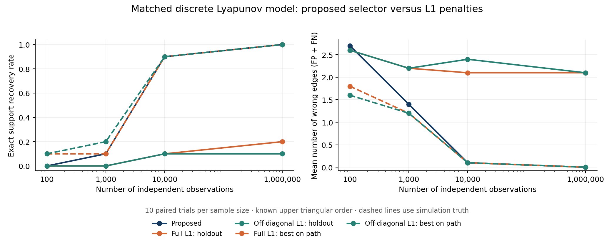

# Quick L1 support-recovery comparison

Date: 2026-10-12. Input: the 40 saved trials in
`experiments/output/fixed_support_scaling_n4_upper_scope_fit_omega_ref_true_greedy`.
Original simulations and production estimator code were not modified.

## Matched estimator

For each empirical covariance S, fit

    min_Lambda ||S - Lambda.T S Lambda - omega_ref I||_F^2
               + alpha sum_ij |Lambda_ij|.

`full_l1` penalizes all upper-triangular entries, including the diagonal.
`offdiagonal_l1` penalizes only strict-upper entries. Both use the same known
upper-triangular order and noise-reference rule as the proposed estimator:
omega_ref=.93*lambda_min(S). Diagonal entries have absolute value at most
.999999 to ensure stability. Lower-triangular entries are fixed to zero.
This is an L1-penalized nonlinear discrete Lyapunov estimator, not a linear
regression Lasso or graphical lasso estimator of inverse-covariance support.

The sweep contains alpha/||S||_op^2 = 0 and 29 log-spaced positive values from
1e-7 to 1. The normalized scale is computed from the available covariance.
No true parameters or true supports enter fitting, initialization, or tuning.

The nonconvex fitting routine splits each off-diagonal coefficient into its
positive and negative parts, yielding a smooth bound-constrained objective.
It explores eight diagonal-sign branches (the remaining eight are global sign
flips with identical loss and penalty). Every positive penalty uses both a
warm start and a dense exact covariance-factorization start in each branch.
The numerical solver uses analytic gradients and L-BFGS-B; no global-optimum
claim is made.

## Tuning and refitting

The original zero-mean Gaussian sample rows were regenerated with their
original seed (trial seed + 2). Every regenerated full covariance matched the
saved covariance to 2e-12 absolute/relative tolerance. Population truth was
used only for this simulation reconstruction and final evaluation.

For each trial, the first 80% of observations train the entire L1 path. The
noise reference is recomputed using training observations only. Each fitted
matrix implies its stationary covariance C, and the final 20% select the
normalized penalty minimizing

    logdet(C) + trace(C^-1 S_validation).

The chosen normalized penalty is then transferred to the full empirical
covariance and the penalized estimator is refitted using all observations.
There is no unpenalized support refit. This is a single holdout split, not
multi-fold cross-validation. File field names `cv` refer to this holdout rule.

`oracle` selects the smallest Hamming-error support on the full-data 30-point
path using simulation truth, with ties favoring the larger penalty. It is
infeasible in practice and is not a known-sparsity-only oracle. It diagnoses
support availability on this numerical grid, not the entire continuum of
penalties. `one_se` is an additional sensitivity rule choosing the largest
penalty within one validation-score standard error of the minimum.

Edges are counted when |Lambda_ij|>1e-5, matching the original fitting threshold.
Precision for an empty selected support is recorded as zero.

## Results

Exact support recovery, out of ten paired trials at each sample size:

| N | Proposed | Full L1, holdout | Full L1, best on grid | Off-diagonal L1, holdout | Off-diagonal L1, best on grid |
|---:|---:|---:|---:|---:|---:|
| 100 | 0 | 0 | 1 | 0 | 1 |
| 1000 | 1 | 0 | 1 | 0 | 2 |
| 10000 | 9 | 1 | 9 | 1 | 9 |
| 1000000 | 10 | 2 | 10 | 1 | 10 |

Mean support Hamming error (FP+FN):

| N | Proposed | Full L1, holdout | Full L1, best on grid | Off-diagonal L1, holdout | Off-diagonal L1, best on grid |
|---:|---:|---:|---:|---:|---:|
| 100 | 2.7 | 2.6 | 1.8 | 2.6 | 1.6 |
| 1000 | 1.4 | 2.2 | 1.2 | 2.2 | 1.2 |
| 10000 | .1 | 2.1 | .1 | 2.4 | .1 |
| 1000000 | 0 | 2.1 | 0 | 2.1 | 0 |

At N=1000000, full-L1 holdout fitting has mean precision .63, recall 1,
and 2.1 false edges. The proposed estimator has precision/recall 1 and no
false edges in these ten trials. The L1 path itself does contain the true
support in every trial: the principal gap is the prediction-based tuning
rule's tendency to retain extra edges.

The additional one-standard-error rule for full L1 has exact counts 0, 0, 0,
7, and Hamming errors 3, 3, 2.5, .3. For off-diagonal L1 these are 0, 0, 0,
0 and 3, 3, 3, 2. This sensitivity illustrates the importance of defining the
tuning rule, rather than treating L1 as a single estimator with fixed recovery
performance.

## Interpretation and limits

The proposed procedure is substantially better for support recovery than this
single-holdout-tuned L1 baseline at N>=10000. Truth-assisted L1 paths are
competitive: their recovery counts and average Hamming errors equal those of
the proposed procedure in the two larger-sample settings.

This is evidence about the whole fitting-and-selection procedures on one
fixed four-variable star graph with known order. It does not show that the
L1 penalty itself is inferior, or establish superiority over differently
tuned/debiased L1 methods. A publication comparison should use several graph
families, more repetitions, stronger tuning baselines, and comparable
verification of numerical fits. The 30-point grid can miss narrow support
intervals. The proposed method uses its saved ADMM fits, while this baseline
uses an independent nonlinear optimizer.

## Verification and artifacts

- Analytic gradient agrees with central finite differences within 3.2e-9.
- Maximum projected-gradient residual over chosen full-data holdout fits:
  9.36e-8 for full L1, 1.12e-7 for off-diagonal L1 (normalized objective).
- The full-L1 holdout exact counts are unchanged at support thresholds 1e-6,
  1e-5, and 1e-4. Off-diagonal L1's N=1000000 exact count changes from 1 to
  2 at threshold 1e-4; the overall conclusion is unchanged.
- All fitted matrices are upper triangular with spectral radius below one.
- `summary.csv`: all summary metrics and selection rules.
- `trial_n*_seed*.json`: penalty choices, path metrics, numerical diagnostics.
- `path_n*_seed*.npz`: full-data and training fitted matrices for both paths.
- `verification.json`: support-threshold sensitivity and stationarity checks.
- `comparison.png`: recovery and Hamming-error comparison.

Reproduce using `python tmp/l1_support_comparison/compare.py --workers 4`, then
`python tmp/l1_support_comparison/report.py`. The numerical runtime required
shared-memory access outside the restricted sandbox on this machine.

